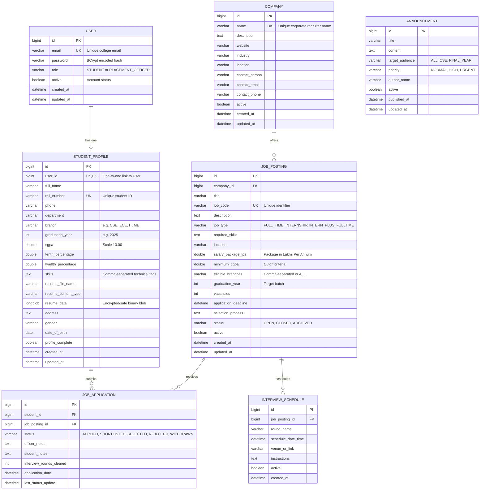

# Entity-Relationship (ER) Diagram & Database Dictionary

## 1. Overview
The **Student Placement Management System (SPMS)** uses a normalized relational database schema (3NF) designed for high integrity, fast indexing, and strict role segregation.

Key design highlights:
- **Authentication & Authorization Separated from Profile**: The `users` table handles credentials (BCrypt hashed) and security authorities (`ROLE_STUDENT`, `ROLE_PLACEMENT_OFFICER`), while `student_profiles` stores academic and placement-specific data.
- **Unique Application Constraint**: The `job_applications` table enforces a composite unique constraint `(student_id, job_posting_id)` to prevent duplicate applications at the database level.
- **Foreign Key Cascades & Indexes**: Indexes are placed on search columns (`email`, `roll_number`, `branch`, `cgpa`, `status`, `application_deadline`, `priority`).

---

## 2. Mermaid Entity-Relationship (ER) Diagram

---

## 3. Data Dictionary

### Table: `users`
| Column | Type | Constraints | Description |
|---|---|---|---|
| `id` | BIGINT | PRIMARY KEY, AUTO_INCREMENT | Unique user identifier |
| `email` | VARCHAR(100) | NOT NULL, UNIQUE, INDEX | Login username |
| `password` | VARCHAR(255) | NOT NULL | BCrypt hashed password (10 rounds) |
| `role` | VARCHAR(30) | NOT NULL, INDEX | Security role (`STUDENT`, `PLACEMENT_OFFICER`) |
| `active` | BOOLEAN | NOT NULL, DEFAULT TRUE | Account lock/active flag |
| `created_at` | DATETIME | NOT NULL | Account creation timestamp |
| `updated_at` | DATETIME | NULL | Timestamp of last credentials update |

### Table: `student_profiles`
| Column | Type | Constraints | Description |
|---|---|---|---|
| `id` | BIGINT | PRIMARY KEY, AUTO_INCREMENT | Profile record identifier |
| `user_id` | BIGINT | NOT NULL, UNIQUE, FK -> users(id) | Associated user account |
| `full_name` | VARCHAR(120) | NOT NULL | Legal name of student |
| `roll_number` | VARCHAR(30) | NOT NULL, UNIQUE, INDEX | Institutional roll / enrollment number |
| `branch` | VARCHAR(50) | NOT NULL, INDEX | Discipline (e.g., CSE, ECE, IT, ME) |
| `graduation_year`| INT | NOT NULL, INDEX | Expected graduation year |
| `cgpa` | DOUBLE | NOT NULL, INDEX | Cumulative Grade Point Average (0.0 to 10.0) |
| `skills` | TEXT | NULL | Technical skill set tags |
| `resume_file_name`| VARCHAR(255) | NULL | Uploaded filename |
| `resume_data` | LONGBLOB | NULL | Uploaded binary resume content |
| `profile_complete`| BOOLEAN | NOT NULL, DEFAULT FALSE | Computed completeness indicator |

### Table: `job_applications`
| Column | Type | Constraints | Description |
|---|---|---|---|
| `id` | BIGINT | PRIMARY KEY, AUTO_INCREMENT | Application identifier |
| `student_id` | BIGINT | NOT NULL, FK -> student_profiles(id) | Applicant ID |
| `job_posting_id`| BIGINT | NOT NULL, FK -> job_postings(id) | Job drive ID |
| `status` | VARCHAR(30) | NOT NULL, INDEX | Lifecycle state (`APPLIED`, `SHORTLISTED`, `SELECTED`, `REJECTED`, `WITHDRAWN`) |
| `interview_rounds_cleared`| INT | NOT NULL, DEFAULT 0 | Count of recruitment rounds cleared |
| `officer_notes`| TEXT | NULL | Placement officer evaluation feedback |
| `composite uk` | UNIQUE(`student_id`, `job_posting_id`) | Ensures single application per drive |
