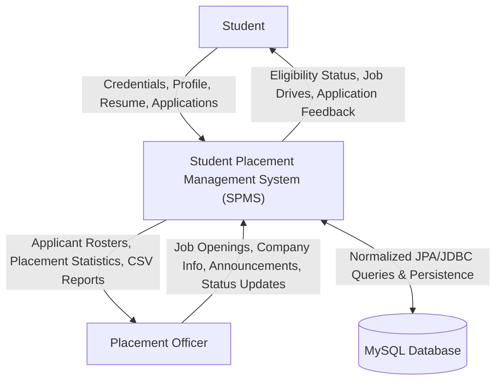
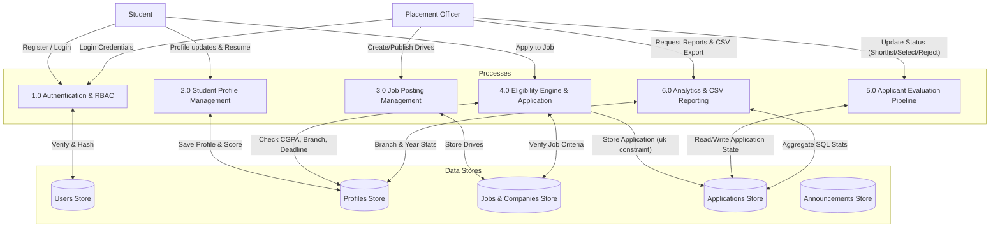
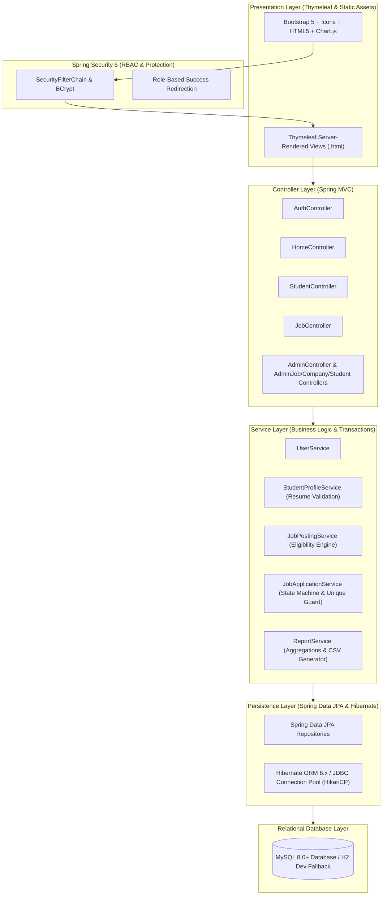

# System Architecture & Diagrams

This document contains visual diagrams for the **Student Placement Management System**, including Use-Case Diagrams, Data Flow Diagrams (DFD Level 0 and Level 1), and the Layered MVC Architecture.

---

## 1. Use-Case Diagram

```mermaid
graph TD
    subgraph Actors
        Student["fa:fa-user Student"]
        Officer["fa:fa-user-tie Placement Officer"]
    end

    subgraph "Student Placement Management System"
        UC1["Register & Log In"]
        UC2["Maintain Profile & Upload Resume"]
        UC3["Browse Open Job Drives"]
        UC4["Server-side Eligibility Verification"]
        UC5["Submit Job Application"]
        UC6["Track Application Status & Withdraw"]
        UC7["View Placement Notices & Schedules"]

        UC8["Manage Partner Companies (CRUD)"]
        UC9["Create & Publish Job Openings"]
        UC10["Review Applicants by Drive & Criteria"]
        UC11["Shortlist / Select / Reject Candidates"]
        UC12["Manage Student Registry & Deactivate"]
        UC13["Broadcast Announcements"]
        UC14["Generate Placement Analytics & CSV Reports"]
    end

    Student --> UC1
    Student --> UC2
    Student --> UC3
    Student --> UC4
    Student --> UC5
    Student --> UC6
    Student --> UC7

    Officer --> UC1
    Officer --> UC8
    Officer --> UC9
    Officer --> UC10
    Officer --> UC11
    Officer --> UC12
    Officer --> UC13
    Officer --> UC14

    UC5 -.->|includes| UC4
```

---

## 2. Data Flow Diagram (DFD)

### Level 0: Context Level DFD

### Level 1: Detailed Data Flow Diagram

---

## 3. Layered MVC Architecture Diagram

